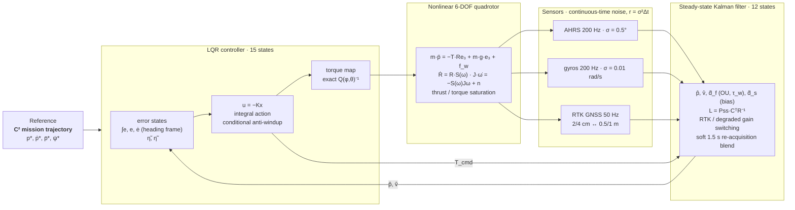
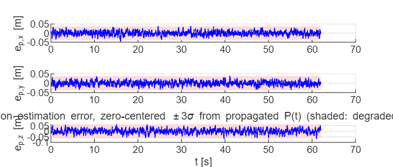
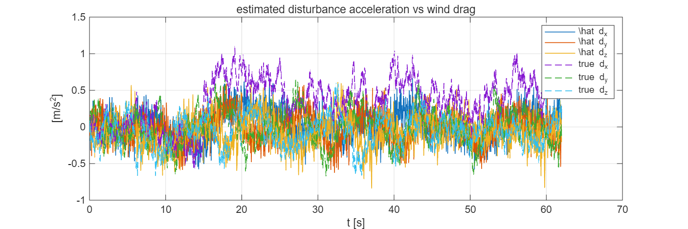
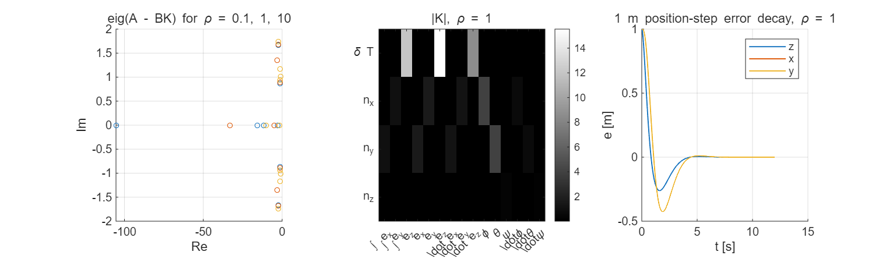
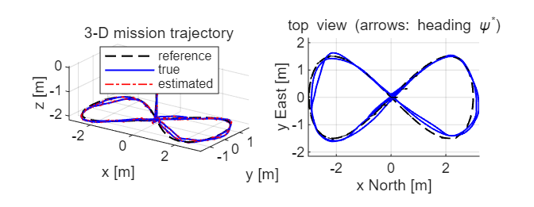
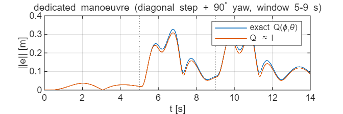

<div align="center">

# Trajectory Tracking of a Quadrotor in Wind

**LQR Control · Kalman-Filter Navigation · RTK GNSS only**

*Aerial Robotics (MSc) · Project 2026 · Prof. C. Silvestre*


</div>

---

A quadrotor flies an inspection mission — **take-off, two figure-eight laps at 2 m, landing** —
through a 2 m/s wind with random gusts, navigating **only** from a low-cost sensor suite:
an AHRS + rate gyros at 200 Hz and an RTK GNSS receiver at 50 Hz whose accuracy degrades
from ±2 cm to ±1 m whenever the RTK fix is lost. Everything is formulated in continuous
time and implemented in Simulink; **one script reproduces every figure, table and the
animation below.**

<div align="center">


*Full 62 s mission, estimated-state flight, wind + gusts from t = 15 s.
Green ellipse: 1-σ horizontal position covariance, RTK / degraded accuracy.*

</div>

---

## ✨ Highlights

- **One multivariable LQR (15 states)** on the hover linearisation of the full rigid-body
  dynamics — position error, integral error, attitude and rates in a single design, with
  conditional-integration **anti-windup**.
- **Exact Euler kinematics in the loop**: torques are computed through
  $n = JQ^{-1}(\ddot\eta_{cmd} - \dot Q\,\omega) + \omega\times J\omega$, not the
  $Q \approx I$ small-angle shortcut — a dedicated tilt-plus-90°-yaw manoeuvre shows the
  coupling error this removes.
- **12-state two-time-scale Kalman filter** estimating position, velocity, a gust
  disturbance $\hat d_f$ (Ornstein–Uhlenbeck with the wind model's time constant) **and a
  slow bias $\hat d_s$** (mean wind drag, model error) — two steady-state gain sets
  switched by the receiver's RTK fix status and **blended softly over 1.5 s at
  re-acquisition** (no estimate jump when the fix returns).
- **Honest validation, not vibes**: analytic linearisation cross-checked against a numerical
  Jacobian (5·10⁻¹²), filter consistency by NEES (9.6 vs. theory 9) and ±3σ coverage
  (99.1 %), deterministic seeded noise so every run reproduces exactly.

## 🏗 System Architecture



*The filter's model acceleration uₐ = −(T_cmd/m)·Re₃ + g·e₃ is built from the **commanded**
thrust and the **measured** attitude; the unmodelled part (wind drag, mass error) is
absorbed by the two disturbance states (gust $\hat d_f$ + bias $\hat d_s$) — in the
model-uncertainty scenario (+20 % mass, +20 % inertia, 20 ms delay) the filter estimates
it to 1.10 m/s².*

## 📊 Results — four scenarios × ideal / estimated states

| Mode | Scenario | RMS 3-D error [m] | Max 3-D error [m] | Hover offset RMS [m] | RMS est. error p / v / d | Max tilt |
|:-----|:---------|-----:|-----:|-----:|:----:|-----:|
| ideal | nominal | 0.063 | 0.160 | 0.034 | — | 16.1° |
| ideal | wind + gusts | 0.063 | 0.160 | 0.034 | — | 16.1° |
| ideal | RTK lost 5 s | 0.063 | 0.160 | 0.034 | — | 16.1° |
| ideal | model uncertainty | 0.056 | 0.149 | 0.031 | — | 15.9° |
| **estimated** | nominal | 0.074 | 0.180 | 0.039 | 0.022 / 0.18 / 0.47 | 18.7° |
| **estimated** | wind + gusts | 0.074 | 0.180 | 0.039 | 0.022 / 0.18 / 0.51 | 18.7° |
| **estimated** | RTK lost 5 s | **0.125** | **0.547** | 0.039 | 0.061 / 0.24 / 0.54 | 30.1° |
| **estimated** | model uncertainty | 0.070 | 0.190 | 0.035 | 0.022 / 0.16 / 1.10 | 19.5° |

*The integral action removes the wind-induced hover offset (0.001 m in hover with wind);
the RTK outage costs 0.55 m peak tracking error and a 30° tilt transient at re-acquisition —
still inside the 35° limit.*

## 🎛 Estimator Tuning (20-run automated sweep)

The final estimator was found by a 20-run `autoresearch` loop on a frozen, bit-exact
deterministic benchmark (estimated-state flight, RTK lost 20–25 s, RMS 3-D error as metric):
the 9-state random-walk disturbance model became a **12-state two-time-scale** one, the
degraded→good gain switch got a **1.5 s soft blend**, and the process-noise intensities were
swept to the tilt-constrained optimum. The complete session — experiment ledger, charter and
frozen benchmark — lives in [`docs/autoresearch/`](docs/autoresearch) (interactive snapshot:
[autoresearch-dashboard.html](docs/autoresearch/autoresearch-dashboard.html)).

<div align="center">

</div>

* **(a)** every experiment against the metric; keeps (green) form the monotone best line
  0.1369 → **0.1249 m** (−8.7 %). **(b)** the gust intensity $q_f$ sweep — RMS keeps dropping
  while tilt rises, and a sharp saturation cliff between $q_f=4$ and $5$ (tilt > 35° *and*
  RMS worse) sets the operating point. Full results table above.

| Kept change | Why it works |
|:--|:--|
| 12-state two-time-scale KF: gust $\hat d_f$ (OU with the wind time constant) + slow bias $\hat d_s$ (RW) | matches the true disturbance structure: mean wind is persistent, gusts decay with $\tau_w = 2$ s |
| soft Lb→Lg gain blend at RTK re-acquisition | no estimate jump when the fix returns; the transient actually lives *inside* the outage |
| $q_f = 4.0$ — the theory-matched value 0.2 was **not** optimal | faster gust-state tracking beats noise injection, up to the tilt cliff |
| $q_s = 0.05$ (geometric sweep 1.0 → 0.05, converged) | with $\hat d_f$ owning the fast path, the bias state can be near-frozen |


## 🖼 Figure Gallery

<table>
<tr>
<td width="50%"><br><sub>Position estimation error inside ±3σ bounds; bounds widen during the degraded-fix window</sub></td>
<td width="50%"><br><sub>The disturbance state d̂ recovers the mean wind drag (k_d·v_w/m ≈ 0.42 m/s² from t = 15 s) and tracks gusts</sub></td>
</tr>
<tr>
<td width="50%"><br><sub>Estimation error growth during the 5 s RTK outage</sub></td>
<td width="50%"><br><sub>Closed-loop eigenvalues vs ρ, gain structure |K|, 1 m step decays</sub></td>
</tr>
<tr>
<td width="50%"><br><sub>3-D + top view: reference, true and estimated trajectories</sub></td>
<td width="50%"><br><sub>Exact Q(φ,θ) vs Q ≈ I in the combined tilt + 90°-yaw manoeuvre</sub></td>
</tr>
</table>

*More in [`report/figs/`](report/figs): attitude & heading, thrust/torque commands, wind
profile, position tracking errors.*

## ✅ Built-in Verification

Every design step carries a numerical self-check (`main.m` asserts them on every run):

| Check | Result |
|:--|:--|
| Analytic A, B vs. numerical Jacobian of the nonlinear error dynamics | 4.9·10⁻¹² rel. |
| Controllability rank (with / without integral states) | 15 / 12 |
| Decoupled chains under state permutation (x-θ, y-φ, z, ψ) | 5 · 5 · 3 · 2 |
| A − BK Hurwitz for all three ρ | ✓ |
| (A, C) observable with position / velocity-only measurements | rank 12 / 9 |
| NEES against steady-state covariance (theory: 9) | 9.4 |
| ±3σ estimation-error coverage (theory: 99.7 %) | 99.5 % |
| Run-to-run determinism (seeded sensor noise) | bit-exact |

## 📁 Repository Layout

```
├── main.m                ← one-click: designs, builds, flies, plots everything
├── matlab/
│   ├── params.m            all vehicle / sensor / wind / mission parameters
│   ├── gen_ref.m           C² reference (quintic-blended segment joins)
│   ├── lin_hover.m         15-state linearisation + rank checks
│   ├── lqr_design.m        Bryson weights, 3× ρ, step metrics
│   ├── kf_design.m         steady-state ARE, 12-state two-time-scale model, dual gains
│   ├── quad_dynamics.m     nonlinear 6-DOF model
│   ├── *_sfun.m            plant / controller / filter / sensor S-functions
│   ├── build_closed.m      builds simulink/closed_loop.slx programmatically
│   ├── run_closed.m        one scenario run + log collection
│   ├── run_scenarios.m     4 scenarios × {ideal, estimated} + metrics table
│   ├── metrics.m           RMS/max errors, hover offset, tilt, effort, NEES
│   ├── make_figures.m      every report figure
│   ├── animate_mission.m   3-D animation → mp4
│   └── test_*.m            plant / closed-loop / filter / bonus verification
├── simulink/
│   ├── closed_loop.slx     the complete controller–estimator loop
│   └── plant_test.slx      open-loop plant model
├── report/                 IEEE-style paper sources + figures
├── docs/                   showcase assets
│   ├── tuning.png          estimator tuning curves (regenerate: make_tuning_fig.py)
│   └── autoresearch/       20-run experiment ledger, charter, frozen benchmark, dashboard
└── (zip regenerated from HEAD, not tracked)
```

## 🚀 Quick Start

```matlab
% MATLAB R2023b+, no toolboxes beyond stock Simulink
main        % ~30 min: designs, builds, flies all scenarios, regenerates
            % every figure of the README + report and the animation
```

Individual verification, each standalone:

```matlab
test_plant    % open-loop plant checks (hover, torque response, wind drag)
test_closed   % ideal-state closed loop, nominal + wind
test_kf       % filter tuning sweep, ±3σ / NEES consistency
test_bonus    % Q(φ,θ) manoeuvre, feed-forward comparison, GNSS outages
```

---

<div align="center">
<sub>Built with MATLAB R2025b + Simulink · Level-2 MATLAB S-functions · fixed-step ode4 @ 1 ms · fully reproducible</sub>
</div>
