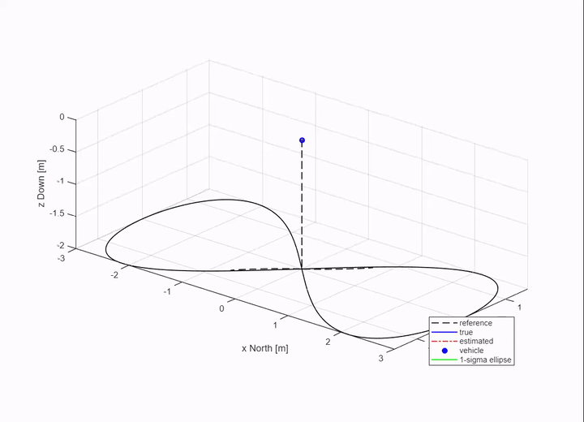
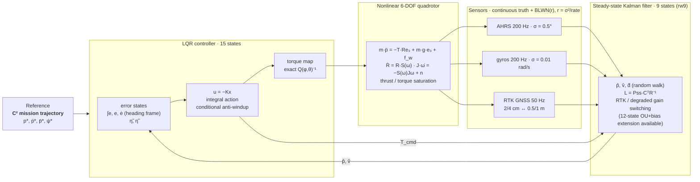
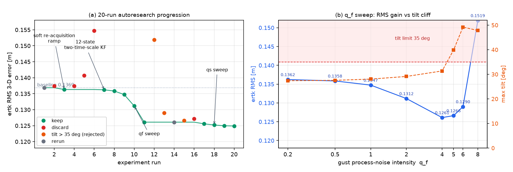
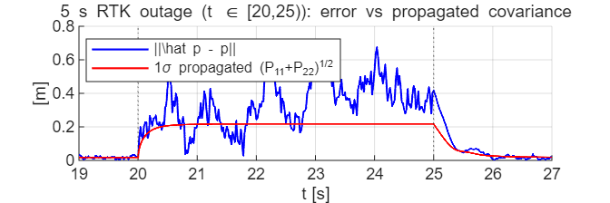
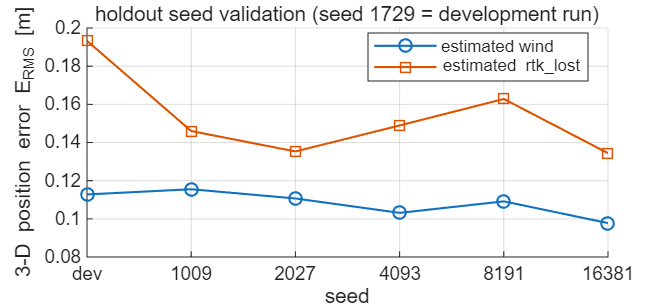

<div align="center">

# Trajectory Tracking of a Quadrotor in Wind

**LQR Control · Kalman-Filter Navigation · RTK GNSS only**

*Aerial Robotics (MSc) · Project 2026 · Prof. C. Silvestre*


</div>

---

A quadrotor flies an inspection mission — **take-off, two figure-eight laps at 2 m, landing** —
through a 2 m/s wind with random gusts, navigating **only** from a low-cost sensor suite:
an AHRS + rate gyros at 200 Hz and an RTK GNSS receiver at 50 Hz whose accuracy degrades
from ±2 cm to ±1 m whenever the RTK fix is lost. Everything is formulated in continuous
time and implemented in Simulink; **one entry point reproduces every figure, table and the
animation below.**

<div align="center">



*Full 62 s mission, estimated-state flight, wind + gusts.
Green ellipse: 1-σ horizontal covariance from the propagated P(t) (eig of P_xy).*

</div>

---

## ✨ Highlights

- **One multivariable LQR (15 states)** on the hover linearisation of the full rigid-body
  dynamics — position error, integral error, attitude and rates in a single design, with
  conditional-integration **anti-windup**. Three Bryson weightings ρ = 0.1/1/10 are
  compared on the full nonlinear mission (error vs. effort of the **applied** input).
- **Exact Euler kinematics in the loop**: torques are computed through
  $n = JQ^{-1}(\ddot\eta_{cmd} - \dot Q\,\omega) + \omega\times J\omega$, not the
  $Q \approx I$ small-angle shortcut.
- **Course nine-state Kalman filter** `[p; v; d]` as the formal baseline, with two
  steady-state gains switched by the RTK fix status (hard switch; 1.5 s soft blend and a
  12-state two-time-scale model kept as documented extensions).
- **Honest validation**: analytic linearisation vs numerical Jacobian (5·10⁻¹²), a
  model-matched linear calibration of the statistics (ANEES 9.28, CI ±1.44), zero-centered
  ±3σ bounds from the **propagated** P(t) — never error-centered — and five independent
  holdout seeds for the key scenarios.

## 🏗 System Architecture



*One wind signal (mean step at t = 15 s + OU-filtered gusts, pole −1/τ, τ = 2 s) is wired
to **both** the plant and the log. The filter's model acceleration
uₐ = −(T_cmd/m)·Re₃ + g·e₃ uses the **commanded** thrust and the **measured** attitude;
the physical disturbance truth used for scoring is
d_model = a_true − ua_ideal (wind drag + mass/actuation error), computed from the
applied thrust and logged alongside.*

## 📊 Results — 10-run core matrix (seed 1729)

<!-- filled from results/full_20261120_054523/metrics.json -->

| Mode | Scenario | RMS 3-D error [m] | Max 3-D error [m] | Hover offset ‖b‖ [m] | est. p/v/d RMS | Max tilt | effort U_RMS |
|:-----|:---------|-----:|-----:|-----:|:----:|-----:|-----:|
| ideal | nominal | 0.028 | 0.123 | 0.033 | N/A | 15.2 | 0.09 |
| ideal | wind | 0.102 | 0.248 | 0.089 | N/A | 17.1 | 0.11 |
| ideal | RTK degraded 5 s | 0.102 | 0.248 | 0.089 | N/A | 17.1 | 0.11 |
| ideal | uncert. J +20% | 0.112 | 0.391 | 0.082 | N/A | 16.9 | 0.41 |
| ideal | uncert. J −20% | 0.112 | 0.391 | 0.080 | N/A | 16.6 | 0.40 |
| estimated | nominal | 0.029 | 0.114 | 0.029 | 0.025/0.17/0.20 | 15.5 | 0.17 |
| estimated | wind | 0.113 | 0.260 | 0.092 | 0.025/0.17/0.30 | 17.4 | 0.18 |
| estimated | RTK degraded 5 s | 0.193 | 0.924 | 0.092 | 0.108/0.25/0.32 | 34.0 | 0.25 |
| estimated | uncert. J +20% | 0.133 | 0.522 | 0.087 | 0.024/0.17/0.47 | 17.1 | 0.45 |
| estimated | uncert. J −20% | 0.134 | 0.522 | 0.084 | 0.024/0.17/0.47 | 16.6 | 0.44 |

*Both uncertainty scenarios are mass +20 % with a 20 ms input delay; inertia ±20 %.
All numbers come from the frozen batch `results/<execution_id>/metrics.json` — same
source as the paper's table.*

## 🎛 Estimator Tuning (historical record)

The 12-state two-time-scale filter, the soft re-acquisition blend and the
process-noise operating points were explored in an earlier **20-run autoresearch sweep on
the pre-fix windfield** (single dev seed). That windfield had the gust generator wired to
the plant but **not** the mean wind, and a 0.5 s effective OU time constant — so those
RMS numbers are **historical only** and are not comparable with the current results
(see [docs/autoresearch/HISTORY.md](docs/autoresearch/HISTORY.md) and
[docs/optimization-plan/PROGRESS.md](docs/optimization-plan/PROGRESS.md)). The current
baseline sweeps the parameters that are actually consumed by the active model mode:
`test_kf` (rw9: q_a × q_d; ou_bias12: q_a/q_f/q_s).

<div align="center">

</div>

## 🖼 Figure Gallery

<table>
<tr>
<td width="50%"><br><sub>Position estimation error inside zero-centered ±3σ bounds from propagated P(t); shaded: degraded/no-fix</sub></td>
<td width="50%"><br><sub>D̂ vs physical disturbance truth d_model (wind drag + model error); wind-drag component dashed</sub></td>
</tr>
<tr>
<td width="50%"><br><sub>Error growth during the 5 s RTK outage vs propagated covariance</sub></td>
<td width="50%"><br><sub>Closed-loop eigenvalues vs ρ, gain structure |K|, 1 m step recovery</sub></td>
</tr>
<tr>
<td width="50%"><br><sub>3-D + top view: reference, true and estimated trajectories</sub></td>
<td width="50%"><br><sub>Five independent holdout seeds reproduce the two key estimated scenarios</sub></td>
</tr>
</table>

*More in [`report/figs/`](report/figs): attitude & heading, thrust/torque commands, wind
profile, position errors, ρ comparison, hover integral ablation, feed-forward, GNSS
outages, Q comparison, step-size sensitivity.*

## ✅ Built-in Verification

Every design step carries a numerical self-check (`main('full')` and the `test_*` scripts
assert them on every run):

| Check | Result |
|:--|:--|
| Analytic A, B vs. numerical Jacobian of the nonlinear error dynamics | 4.9·10⁻¹² rel. |
| Controllability rank (with / without integral states) | 15 / 12 |
| Decoupled chains under state permutation (x-θ, y-φ, z, ψ) | 5 · 5 · 3 · 2 |
| A − BK Hurwitz for all three ρ; A − LC Hurwitz in both fix modes | ✓ |
| (A, C) observable: position / velocity-only (rw9) | rank 9 / 6 |
| Wind: `none` applies exactly 0; mean step 2 m/s at t = 15 s; OU τ = 2 s | ✓ (impulse 1/e at 2.00 s + 3-seed ensemble) |
| GNSS fix status [t₀,t₁) semantics: 1 → 0 (degraded) / −1 (no fix) → 1 | ✓ |
| Statistics machinery: linear model-matched ensemble ANEES / coverage | 9.28 (CI ±1.44) / 99.4 % |
| Disturbance identity a_true = ua_meas + d_model + d_input_noise | < 10⁻⁹ every run |
| Run-to-run determinism (seeded noise streams) | bit-exact |

## 📁 Repository Layout

```
├── main.m                ← thin public entry: main('full') | main('quick')
├── matlab/
│   ├── params.m            all vehicle / sensor / wind / mission / seed parameters
│   ├── run_project.m       orchestration: designs, builds, flies, plots, exports
│   ├── gen_ref.m           C² reference (mission / q_maneuver / hover_validation)
│   ├── lin_hover.m         15-state linearisation + rank checks
│   ├── lqr_design.m        Bryson weights, 3× ρ, standard recovery metrics
│   ├── kf_design.m         steady-state ARE: rw9 baseline + ou_bias12 extension
│   ├── kf_sfun.m           filter S-function (fix-status gains, nx-driven)
│   ├── propagate_covariance.m  P(t) for the ACTUAL gain schedule (RK4)
│   ├── quad_dynamics.m     nonlinear 6-DOF model
│   ├── *_sfun.m            plant / controller / reference S-functions
│   │                       (sensor_sfun.m = legacy sample-hold extension, not wired)
│   ├── build_closed.m      builds simulink/closed_loop.slx programmatically
│   ├── run_closed.m        one scenario run + full log contract (applied inputs, truths)
│   ├── run_scenarios.m     the 10 core runs into results/<execution_id>/<case_id>/
│   ├── metrics.m           one metric definition set (3-D vector RMS, d_model truth,
│   │                       segment-wise coverage / NEES / innovations)
│   ├── make_figures.m      every report figure from ONE batch
│   ├── export_results.m    metrics.json + LaTeX macros + core table
│   ├── animate_mission.m   3-D animation → mp4
│   └── test_*.m            plant / wind / closed-loop / filter / bonus verification
├── simulink/
│   ├── closed_loop.slx     the complete controller–estimator loop
│   └── plant_test.slx      open-loop plant model
├── report/                 IEEE-style paper sources + figures + metrics macros
├── results/                <execution_id>/<case_id>/run.mat + scenarios.mat + metrics.json
├── docs/
│   ├── optimization-plan/  audit register, phased plan, acceptance contract, PROGRESS.md
│   └── autoresearch/       historical 20-run sweep archive (read-only, see HISTORY.md)
└── tools/package_submission.py   clean deliverable ZIP packager
```

## 🚀 Quick Start

```matlab
% MATLAB R2025b (R2023b+ works), Simulink + Control System Toolbox
main('full')    % ~45 min: rebuilds models, runs the 10-run core matrix, the ρ
                % comparison, control experiments, bonus runs, holdout seeds,
                % step-size check; regenerates every figure, the metrics export
                % and the animation in a NEW results/<execution_id>/ batch
main('quick')   % ~5 min: build + design + nominal/wind sanity runs
```

Individual verification, each standalone:

```matlab
test_plant    % open-loop plant checks (hover, torque response, wind drag)
test_wind     % wind modes, OU statistics, GNSS status sequences, delay bookkeeping
test_closed   % ideal-state closed loop, nominal + wind
test_kf       % linear statistics calibration + per-mode tuning sweep
test_bonus    % FF sign, hover integral ablation, Q manoeuvre, GNSS outages
```

Every full run writes to a fresh `results/<execution_id>/` — nothing from a previous
batch is overwritten, and reruns never collide (`run_id = execution_id/case_id`).

---

<div align="center">
<sub>Built with MATLAB R2025b + Simulink · Level-2 MATLAB S-functions · fixed-step ode4 @ 1 ms · fully reproducible from main('full')</sub>
</div>
